# Python Visualization Libraries: A Beginner's Guide to Matplotlib and Plotly

## Table of Contents
1. Library Overview
2. Graph Types (Matplotlib, Plotly)
3. Comparison
4. Resources

---

## 1. Library Overview

### Matplotlib
Matplotlib is the oldest and most widely used plotting library in Python. Many other libraries (Seaborn and Pandas plotting, for example) are built on top of it.

**Unique features**
- Full control over every element of a figure (axes, ticks, labels, colors, fonts).
- Produces high-quality static images (PNG, PDF, SVG) suitable for reports and academic papers.
- Huge community, lots of tutorials, works everywhere (scripts, Jupyter, servers).

**Typical use cases**
- Quick exploratory plots while analyzing data.
- Publication-ready figures for papers and reports.
- Custom, highly specific chart layouts.

**Install**
```bash
pip install matplotlib
```

### Plotly
Plotly is a library for creating **interactive** charts. Plots can be zoomed, panned, and hovered over to reveal values. They render in Jupyter notebooks, browsers, and web dashboards.

**Unique features**
- Interactivity by default (hover tooltips, zoom, pan, legend toggling).
- `plotly.express` gives a short, high-level syntax for most chart types.
- Can export to standalone HTML files and powers dashboards through Dash.
- Wide chart variety, including 3D plots, maps, and financial charts.

**Typical use cases**
- Dashboards and web apps.
- Presentations and reports where the audience explores the data.
- Maps and 3D visualizations.

**Install**
```bash
pip install plotly pandas
```

---

## 2. Graph Types

Every example below shows the code first, followed by the chart it produces.

Sample data used in the examples:

```python
months = ["Jan", "Feb", "Mar", "Apr", "May"]
sales  = [120, 150, 90, 200, 170]
```

## 2.1 Matplotlib

Standard import:
```python
import matplotlib.pyplot as plt
```

### Line Plot
**Description:** Connects data points with a line to show how a value changes, usually over time.
**Use case:** Monthly sales, temperature over a week, stock prices.

```python
plt.plot(months, sales, marker="o")
plt.title("Monthly Sales")
plt.xlabel("Month")
plt.ylabel("Sales")
plt.show()
```

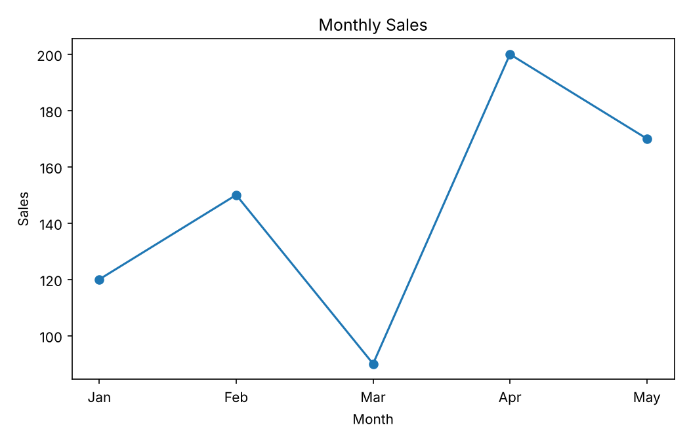

### Scatter Plot
**Description:** Shows individual points to reveal the relationship between two numeric variables.
**Use case:** Study hours vs. exam scores, height vs. weight.

```python
hours  = [1, 2, 3, 4, 5, 6, 7, 8]
scores = [35, 45, 50, 60, 65, 72, 80, 88]

plt.scatter(hours, scores, color="green")
plt.title("Study Hours vs. Exam Score")
plt.xlabel("Hours Studied")
plt.ylabel("Score")
plt.show()
```

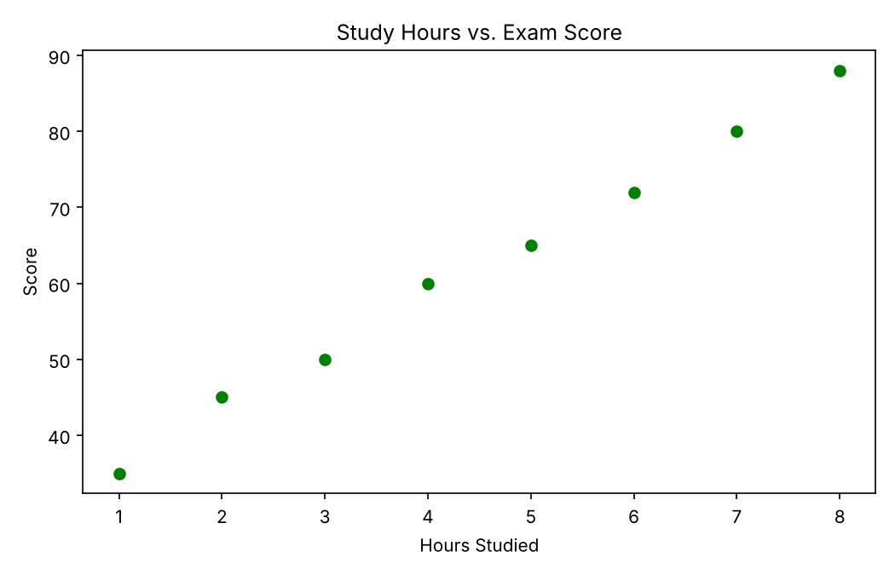

### Bar Chart
**Description:** Uses rectangular bars to compare values across categories.
**Use case:** Sales per product, number of students per class.

```python
plt.bar(months, sales, color="skyblue")
plt.title("Sales by Month")
plt.xlabel("Month")
plt.ylabel("Sales")
plt.show()
```

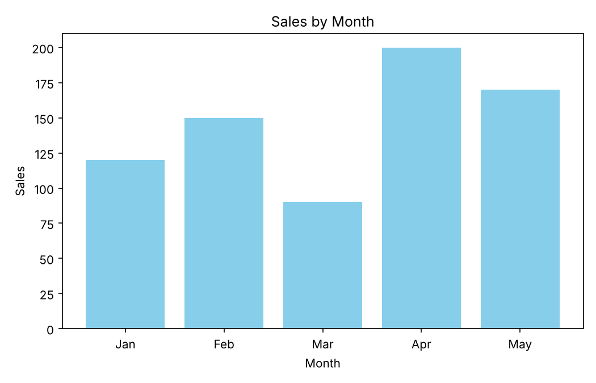

### Histogram
**Description:** Groups numeric data into bins and counts how many values fall in each bin, showing the data's distribution.
**Use case:** Distribution of ages, test scores, or delivery times.

```python
import random
random.seed(42)  # makes the random data the same every run
data = [random.gauss(50, 10) for _ in range(500)]

plt.hist(data, bins=20, color="orange", edgecolor="black")
plt.title("Distribution of Values")
plt.xlabel("Value")
plt.ylabel("Frequency")
plt.show()
```

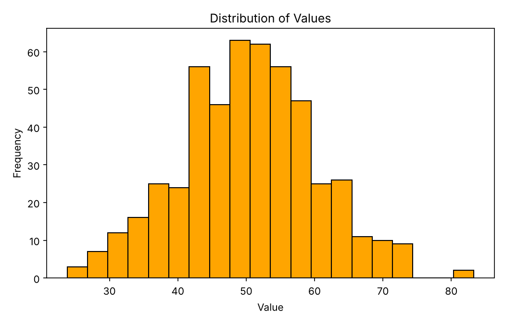

### Pie Chart
**Description:** Divides a circle into slices to show each category's share of a whole.
**Use case:** Market share, budget breakdown (best with only a few categories).

```python
labels = ["Rent", "Food", "Transport", "Savings"]
amounts = [40, 25, 15, 20]

plt.pie(amounts, labels=labels, autopct="%1.1f%%")
plt.title("Monthly Budget")
plt.show()
```

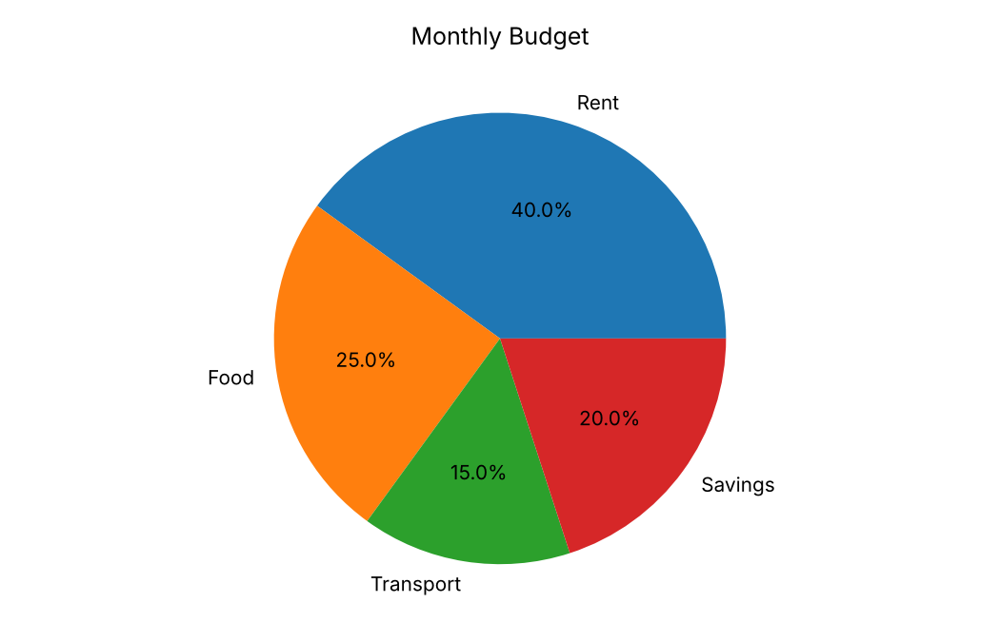

### Box Plot
**Description:** Summarizes a distribution with its median, quartiles, and outliers.
**Use case:** Comparing the spread of scores between groups.

```python
group_a = [55, 60, 62, 65, 70, 72, 90]
group_b = [40, 50, 55, 58, 60, 61, 63]

plt.boxplot([group_a, group_b], tick_labels=["Group A", "Group B"])
plt.title("Score Comparison")
plt.ylabel("Score")
plt.show()
```

> Note: in Matplotlib versions before 3.9 the option is called `labels` instead of `tick_labels`.

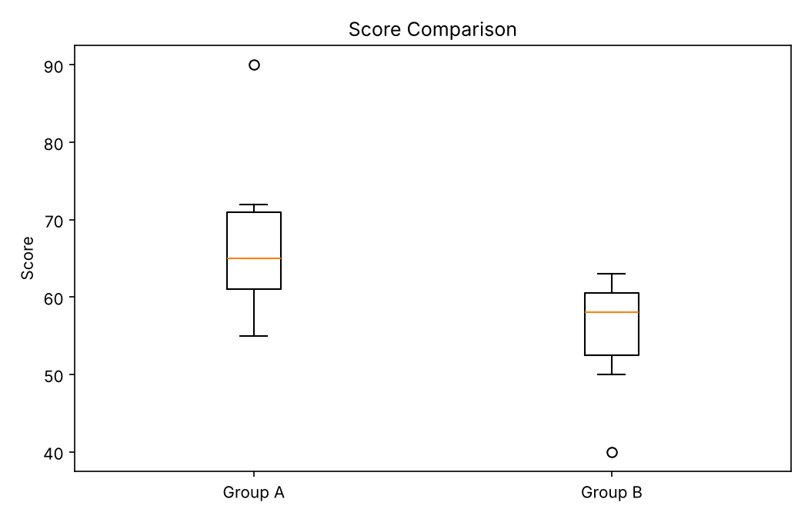

## 2.2 Plotly

Standard import (Plotly Express is the beginner-friendly interface):
```python
import plotly.express as px
```

> In a Jupyter notebook, `fig.show()` displays the chart inline. In a normal script it opens the chart in your browser. The images below are static snapshots; in a browser the real charts also let you hover, zoom, and pan.

### Line Plot
**Description:** Connects points with a line; hovering shows exact values.
**Use case:** Trends over time that viewers want to inspect point by point.

```python
fig = px.line(x=months, y=sales, markers=True,
              title="Monthly Sales",
              labels={"x": "Month", "y": "Sales"})
fig.show()
```

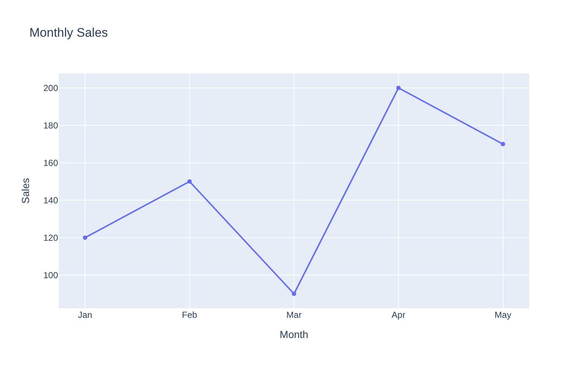

### Scatter Plot
**Description:** Plots points for two numeric variables; hover reveals each point's values, and you can zoom into dense regions.
**Use case:** Exploring relationships and spotting outliers.

```python
hours  = [1, 2, 3, 4, 5, 6, 7, 8]
scores = [35, 45, 50, 60, 65, 72, 80, 88]

fig = px.scatter(x=hours, y=scores,
                 title="Study Hours vs. Exam Score",
                 labels={"x": "Hours Studied", "y": "Score"})
fig.show()
```

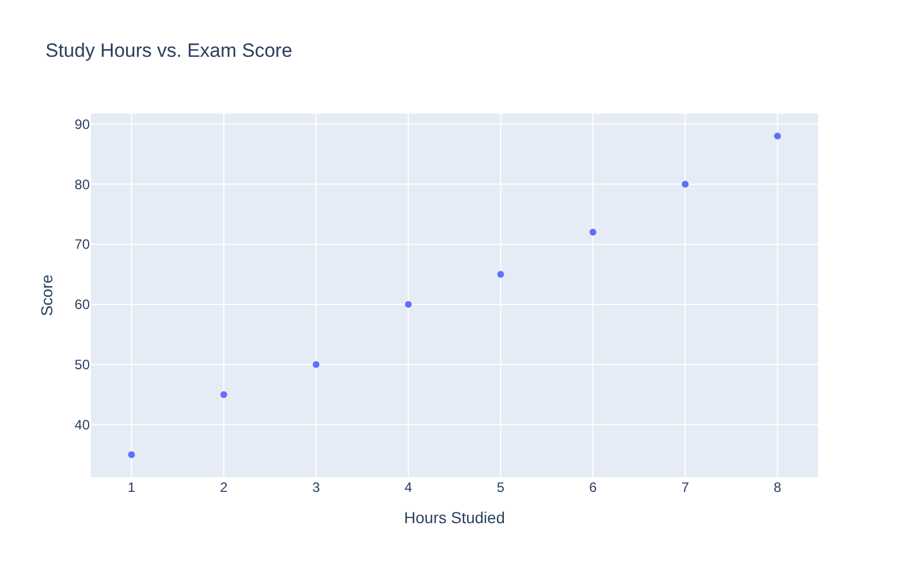

### Bar Chart
**Description:** Compares values across categories using bars, with hover tooltips.
**Use case:** Sales per product, counts per category.

```python
fig = px.bar(x=months, y=sales,
             title="Sales by Month",
             labels={"x": "Month", "y": "Sales"})
fig.show()
```

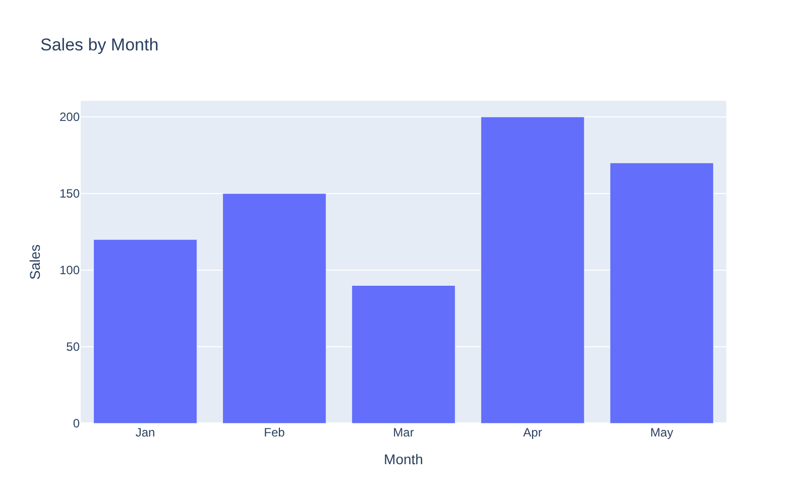

### Histogram
**Description:** Shows the distribution of a numeric variable using bins.
**Use case:** Understanding how values are spread, such as ages or prices.

```python
import random
random.seed(42)
data = [random.gauss(50, 10) for _ in range(500)]

fig = px.histogram(x=data, nbins=20, title="Distribution of Values")
fig.show()
```

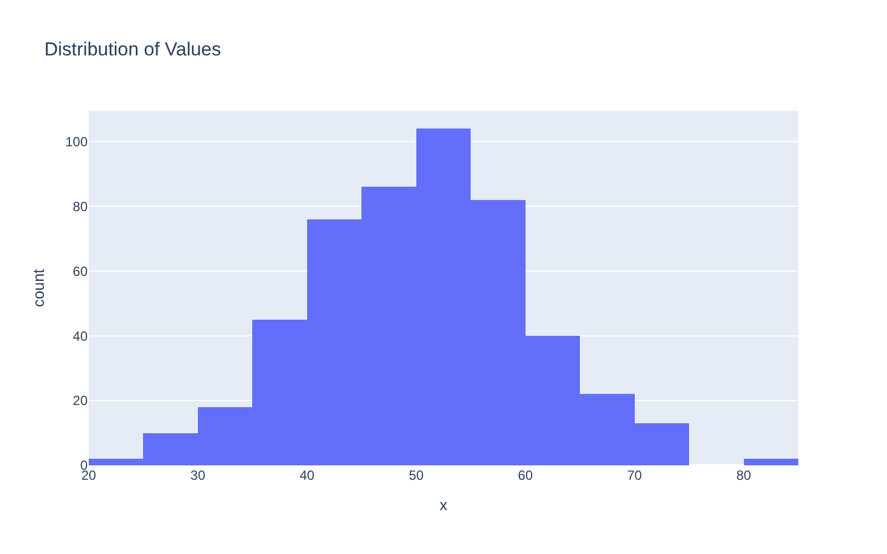

### Pie Chart
**Description:** Shows each category's share of a whole; slices can be hidden by clicking the legend.
**Use case:** Budget breakdowns, survey results.

```python
fig = px.pie(names=["Rent", "Food", "Transport", "Savings"],
             values=[40, 25, 15, 20],
             title="Monthly Budget")
fig.show()
```

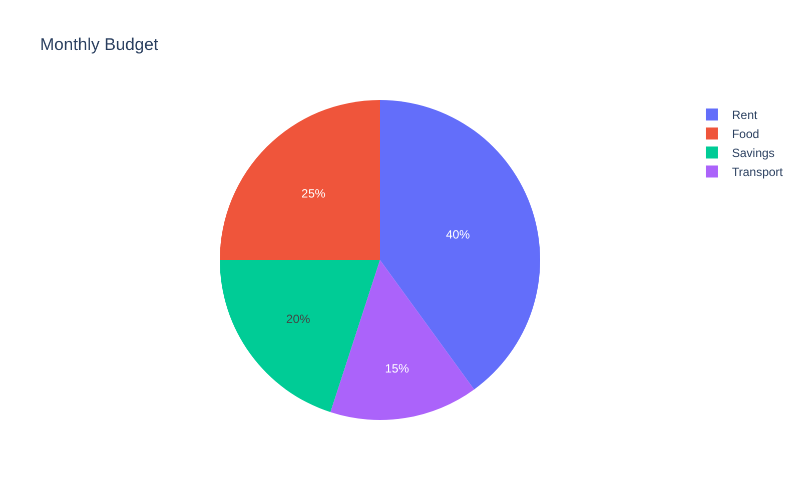

### Box Plot
**Description:** Displays median, quartiles, and outliers; hovering shows the exact statistics.
**Use case:** Comparing distributions between groups.

```python
import pandas as pd

df = pd.DataFrame({
    "score": [55, 60, 62, 65, 70, 72, 90, 40, 50, 55, 58, 60, 61, 63],
    "group": ["A"] * 7 + ["B"] * 7,
})

fig = px.box(df, x="group", y="score", title="Score Comparison")
fig.show()
```

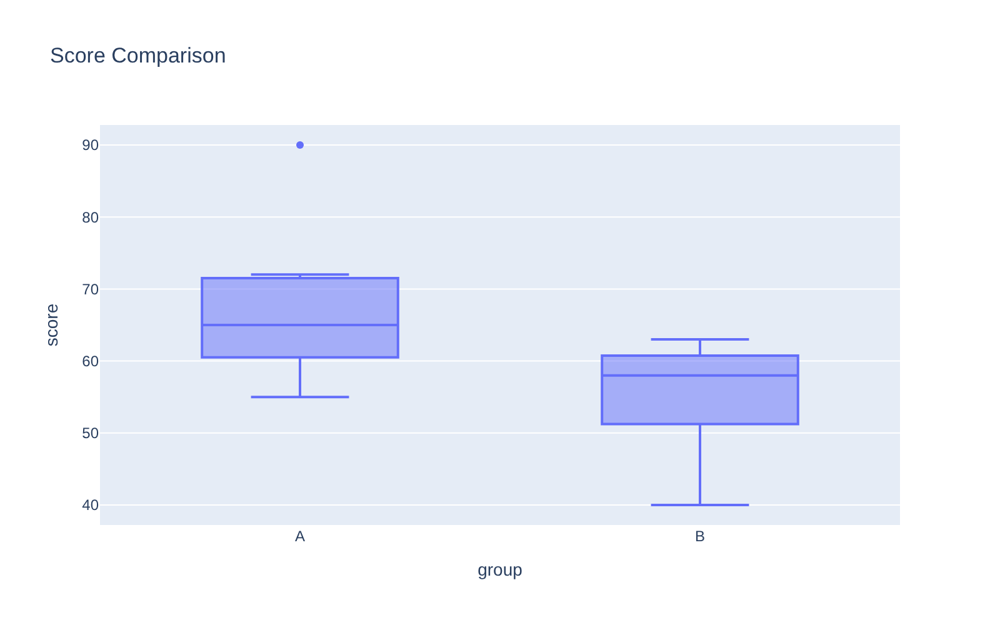

### Saving Charts

**Plotly: interactive HTML (keeps hover and zoom)**
```python
fig.write_html("chart.html")
```

**Plotly: static image** (needs `pip install kaleido`; recent versions also need Google Chrome installed)
```python
fig.write_image("chart.png")
```

**Matplotlib: static image**
```python
plt.savefig("chart.png", dpi=150)   # call this before plt.show()
```

---

## 3. Comparison

| Criteria | Matplotlib | Plotly |
|---|---|---|
| **Ease of use** | Moderate. Simple plots are easy, but good-looking plots need extra code. | Easy. `plotly.express` produces polished charts in one line. |
| **Customization** | Excellent. Control over every detail. | Very good, but fine-grained tweaks use nested settings that take time to learn. |
| **Interactivity** | Limited (basic zoom and pan in desktop windows). | Excellent. Hover, zoom, pan, and toggling are built in. |
| **Performance on large datasets** | Good for static images, even with large data. Rendering is fast, though very large scatter plots can be slow. | Can slow down in the browser with hundreds of thousands of points (WebGL variants such as `px.scatter_gl` help). |
| **Output formats** | PNG, PDF, SVG, and others. Great for print and papers. | Interactive HTML, plus static images (needs an extra package). Great for web. |
| **Learning curve** | Steeper for advanced use. | Gentle for beginners. |
| **Best for** | Publication-quality static figures, full control. | Dashboards, exploration, sharing interactive charts. |

### Strengths and Weaknesses

**Matplotlib**
- Strengths: highly flexible, mature, huge community, great for print-quality output, the foundation of the Python plotting ecosystem.
- Weaknesses: verbose code for attractive results, default style looks dated, limited interactivity.

**Plotly**
- Strengths: interactive out of the box, modern look, concise syntax, works well for web dashboards.
- Weaknesses: slower with very large datasets, larger file sizes for exported HTML, less suitable for strict print layouts.

### Which Should a Beginner Choose?
- Start with **Matplotlib** to understand the fundamentals of plotting in Python and to produce static figures.
- Use **Plotly** when you want interactive charts to explore or share with others.
- Many people use both: Matplotlib for reports and Plotly for dashboards.

---

## 4. Resources

- Matplotlib quick start: https://matplotlib.org/stable/users/explain/quick_start.html#quick-start
- Plotly (Python) docs: https://plotly.com/python/distplot/
- Plotly Express overview: https://plotly.com/python/plotly-express/
- Matplotlib gallery of examples: https://matplotlib.org/stable/gallery/index.html
